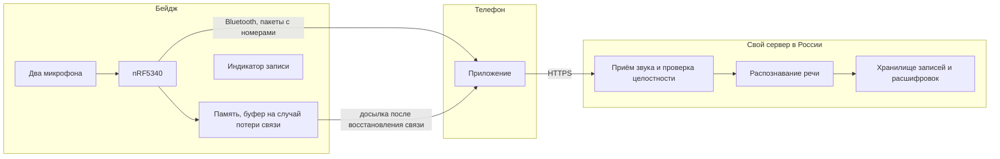

# Идея: бейдж-диктофон, у которого записи остаются у владельца

## Коротко

Носимый бейдж записывает разговоры и отправляет звук на сервер, который принадлежит самому пользователю или его компании. Ни звук, ни расшифровка не уходят в облако производителя устройства или в сторонние сервисы распознавания. Основа - открытый проект Omi, к которому добавляется то, чего не хватает для российского рынка - эт свой сервер внутри страны и защиту от обвинений в скрытой записи.

## Кому это нужно

Идея выросла из анализа рынка (был учебный проект, где анализировал рынок петличек-транскрибаторов) (подробнее в [market-notes.md](market-notes.md)). Был сделан вывод, что необходимо начинать с частных пользователей, потом идти в компании.

**Частные пользователи на старте.** Люди, у которых много разговоров вживую и мало времени разбирать записи (предприниматели, журналисты, преподаватели, студенты). Им важно нее тратить часы на расшифровку. Таких проще всего найти и проще проверить на них гипотезы.

**Компании следующим шагом.** Там главный вопрос - где лежат записи. Разговоры с клиентами и совещания содержат персональные данные и коммерческую тайну. По закону о персональных данных записывать, хранить и обрабатывать данные граждан России нужно в базах, которые находятся в России [6]. Готовые бейджи Plaud и TicNote хранят всё в своих зарубежных облаках, и компании это не подходит (см. [devices.md](devices.md)). Свой сервер в России решает эту проблему.

## Почему не взять готовое устройство

В [devices.md](devices.md) видно, что закрытые устройства не дают нормально забрать исходный звук и привязаны к облаку производителя. Яндекс, судя по анонсу, тоже сделает ставку на свою экосистему, Яндекс 360 [5]. Остаётся Omi: у него открыты прошивка, приложение и сервер, звук передаётся по Bluetooth в описанном формате [1], [2].

## Что берём готовым

- **Железо Omi как отправную точку.** Плата на чипе nRF5340 с Bluetooth, два цифровых микрофона и встроенная память [3]. Файлы платы открыты, их можно заказать на производстве или переделать [3].
- **Прошивку Omi.** Она уже умеет сжимать звук кодеком Opus и передавать его по Bluetooth [2], также писать без связи и потом досылать записи [4].
- **Протокол передачи звука.** Формат пакетов описан в документации [2], поэтому телефон и сервер можно писать без обратной разработки.
- **Мобильное приложение** как основу для своего. Оно тоже открыто [1].

## Что меняем

**1. Свой сервер вместо чужих облаков.** У Omi сервер открыт, но по умолчанию он отправляет звук в Deepgram для распознавания, данные хранит в Firestore [1]. Заменяются эти части:
- распознавание речи - открытая модель Whisper, которая работает на своём сервере [7];
- хранение - своя база данных на сервере в России, чтобы выполнять закон о персональных данных [6].

**2. Надёжный буфер на случай потери связи.** Если телефон далеко или Bluetooth пропал, звук не должен теряться. Omi уже умеет писать в память без связи [4]. Выделяем требование - устройство хранит в памяти запас записи и досылает его, когда связь появилась, сервер проверяет, что ни один кусок не потерялся. Именно эту проверку автоматизируем во второй части задания.

**3. Шифрование с ключом у владельца.** Как у Яндекса: записи на устройстве зашифрованы, ключ хранится на телефоне владельца [5]. Потерянный бейдж ничего не выдаст.

## Как это устроено

## Сколько стоит железо

Это оценка из рыночного анализа. Она не проверена у поставщиков и нужна, чтобы понять порядок цифр.

| Компонент | Оценка, руб. |
|---|---|
| Два MEMS-микрофона (два нужны для шумоподавления) | 500–800 |
| Главный чип | 500–800 |
| Память для буфера записи | 400–600 |
| Питание | 600–800 |
| Кнопки, светодиод, обвязка | 300–400 |
| **Итого** | **около 2 000–3 000** |

Для сравнения: готовые бейджи из таблицы стоят от $129 до $159 (см. [devices.md](devices.md)).

## Что пока не проверено

- **Себестоимость** Цифры выше - оценка без запросов к поставщикам. В неё не входят корпус, сборка и сертификация.
- **Качество распознавания.** Насколько хорошо Whisper распознаёт русскую речь с бейджа в шумном помещении, нужно проверять на реальных записях.
- **Лицензия на железо Omi.** Файлы платы лежат под MIT [1], эта лицензия написана для программ. Перед производством нужна проверка.
- **Время работы.** Если вместо телефона звук будет чаще уходить по Wi-Fi или дольше храниться в памяти, расход батареи изменится. Это проверяется только на устройстве.

## Источники

[1] Based Hardware. *omi*. GitHub, https://github.com/BasedHardware/omi

[2] Based Hardware. *App-device protocol*. Omi Docs. https://docs.omi.me/doc/developer/Protocol

[3] Based Hardware. *Electronics*. Omi Docs.  https://docs.omi.me/doc/hardware/consumer/electronics

[4] Based Hardware. *Omi AI pendant: Never take notes again*.  https://www.omi.me/pages/pendant

[5] Яндекс. *Яндекс выпустит новое носимое ИИ-устройство - диктофон с Алисой Про*.  https://yandex.ru/company/news/30-10-2025-05

[6] Федеральный закон от 27.07.2006 № 152-ФЗ «О персональных данных». КонсультантПлюс  https://www.consultant.ru/document/cons_doc_LAW_61801/

[7] OpenAI. (n.d.). *whisper*. GitHub. https://github.com/openai/whisper
